# SmartCart – E-Commerce Mobile App (React Native)

SmartCart is an e-commerce app built with React Native (Expo) on top of the
[DummyJSON](https://dummyjson.com/docs) mock API. It covers product browsing, search and
filters, product details, cart and wishlist, a simulated checkout with order history,
abandoned-cart reminders, offline support and tests.

**📦 Download APK:** [Latest release](https://github.com/Suryakanta10/smartcart/releases/latest)

**🎥 Demo video:** [Watch on Google Drive](https://drive.google.com/file/d/1NIGJaJ-3R3Dg8Mg_xty4BparOgtRWuXt/view?usp=sharing)

---

## Screenshots

| Home | Search & Filters | Product Details | Similar Products |
|---|---|---|---|
| 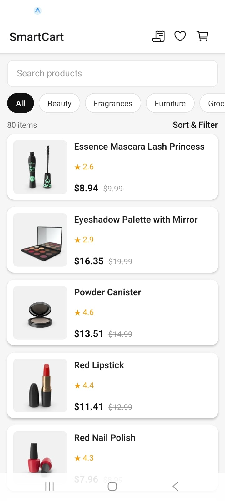 | 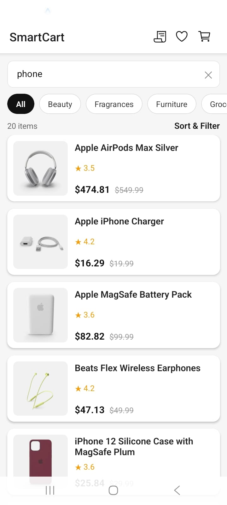 | 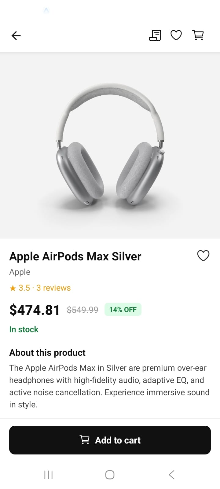 | 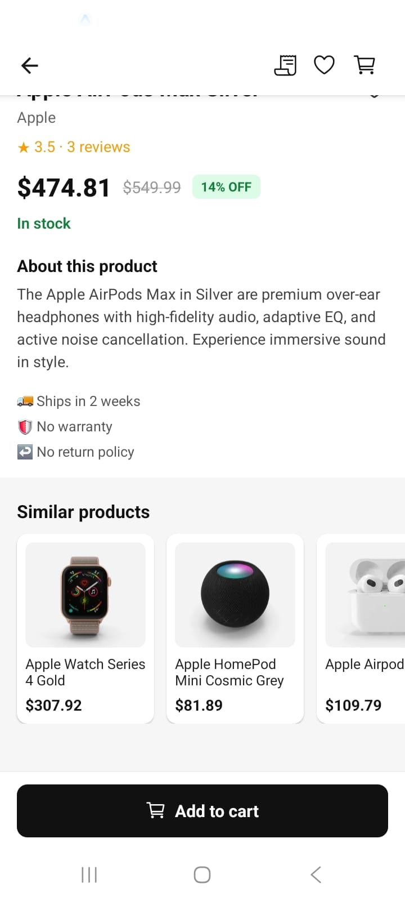 |

| Cart | Wishlist | Checkout Validation | Order Confirmed |
|---|---|---|---|
| 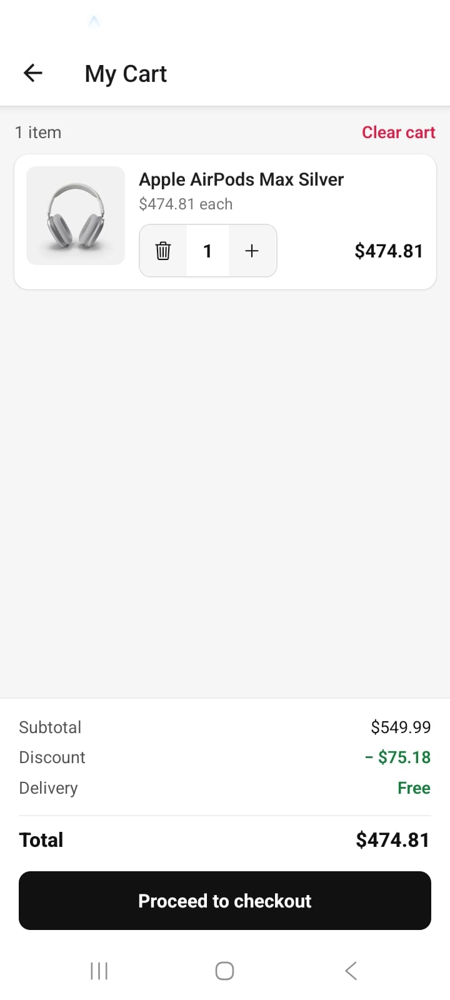 | 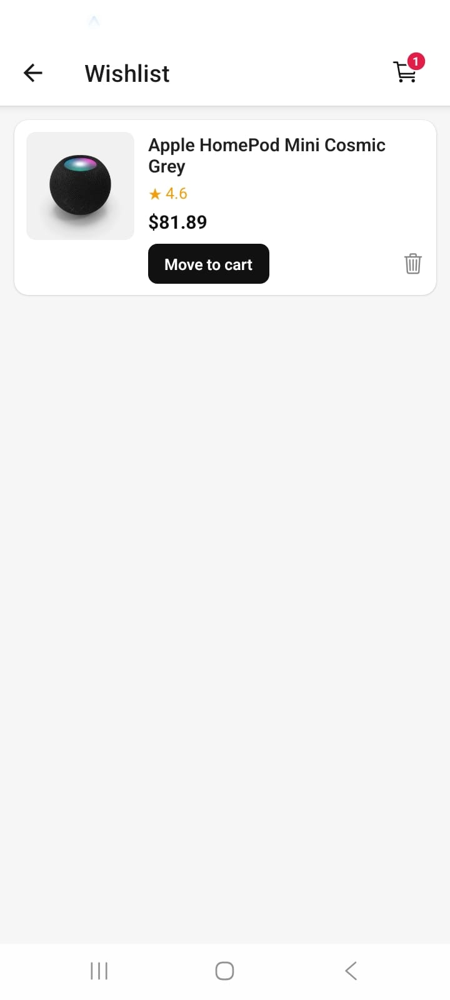 | 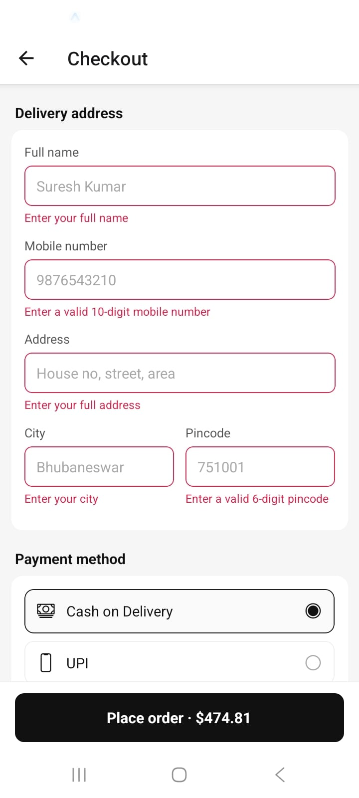 | 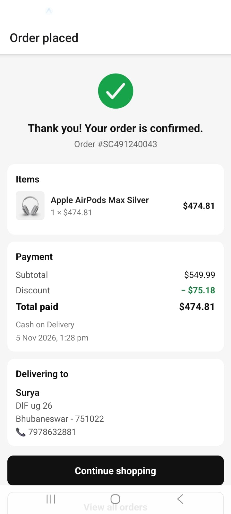 |

| Order History | Offline Mode | Empty Cart | Cart Reminder |
|---|---|---|---|
| 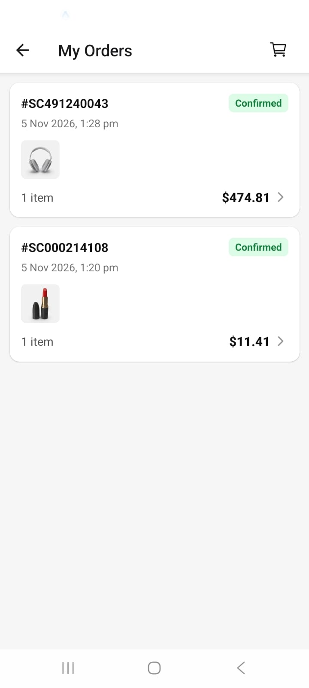 | 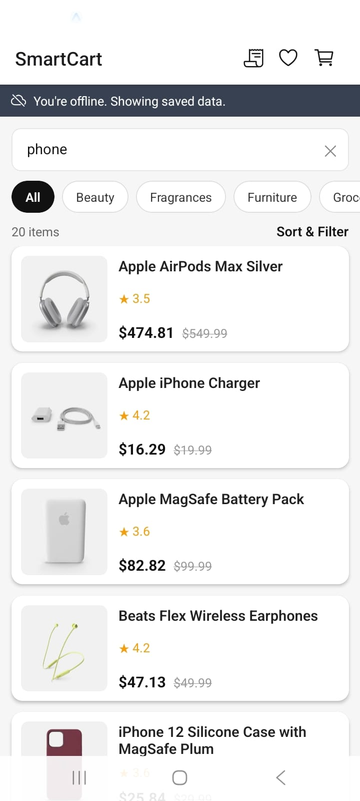 | 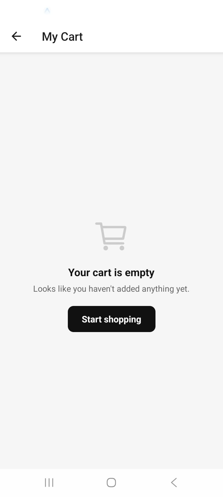 | 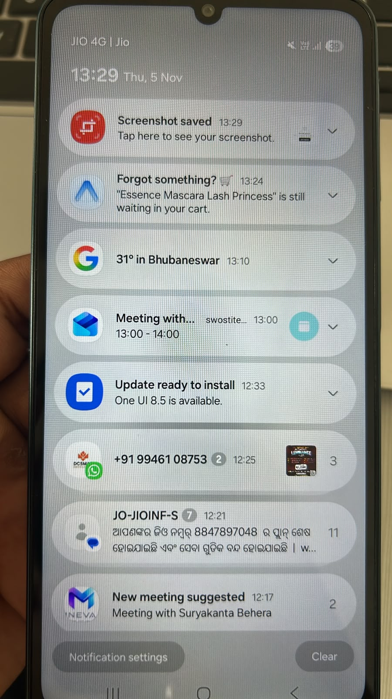 |

---

## Features

| Area | What's implemented |
|---|---|
| **Product listing** | Images, prices (with discount), ratings, infinite scroll pagination, pull-to-refresh, loading / empty / error states |
| **Categories & search** | Categories loaded from the API, 400 ms debounced search, sort (price, rating, name), price range and rating filters |
| **Product details** | Swipeable image gallery with page dots, stock status, wishlist toggle, add to cart with quantity stepper, similar products |
| **Cart & wishlist** | Add / remove / update quantity (capped by stock), subtotal / discount / total, move wishlist items to cart, persisted across restarts |
| **Checkout & orders** | Address form with validation, payment method selection (simulated), order confirmation, order history, last address remembered |
| **Notifications** | Abandoned-cart reminder scheduled when the cart changes, cancelled when the cart is cleared or an order is placed, tap opens the cart |
| **Offline & errors** | Persisted query cache, offline banner, requests pause offline and resume automatically, smart retry with backoff |
| **Performance** | Memoized list items, stable callbacks, tuned FlatList, narrow store selectors, profiler evidence in [`docs/PERFORMANCE.md`](docs/PERFORMANCE.md) |
| **Testing** | 40 Jest tests for cart calculations, search, similar products and notification logic |

---

## Tech Stack

| Purpose | Library |
|---|---|
| Framework | React Native with Expo (JavaScript) |
| Navigation | Expo Router (file-based) |
| Server state | TanStack Query (React Query) + AsyncStorage persister |
| Client state | Zustand with `persist` middleware |
| Storage | AsyncStorage |
| Notifications | expo-notifications (local notifications) |
| Images | expo-image (memory + disk cache) |
| Network status | @react-native-community/netinfo |
| Testing | Jest (jest-expo) + React Native Testing Library |
| Build | EAS Build |

---

## Architecture

### Project structure

```
app/                         # Screens (Expo Router: each file is a route)
  _layout.jsx                # Providers, header, notification setup
  index.jsx                  # Product list + search + filters
  product/[id].jsx           # Product details
  cart.jsx, wishlist.jsx
  checkout.jsx
  order/[id].jsx, orders.jsx

src/
  api/                       # Network layer
    client.js                # fetch wrapper, ApiError, query string helper
    products.js              # DummyJSON endpoints
    queryClient.js           # React Query config, cache persistence, online/focus managers
  hooks/                     # useProducts, useProduct, useSimilarProducts, useCategories,
                             # useDebounce, useIsOffline, useNotificationObserver
  store/                     # Zustand stores: cart, wishlist, orders
  services/                  # Notification service + abandoned-cart reminder logic
  utils/                     # Pure business logic: price, cart, filters,
                             # similar products, validation, order
  constants/                 # Sort / filter options
  components/                # Reusable UI components

__tests__/                   # Jest tests
docs/                        # Performance notes, profiler data, screenshots
```

### Layers

```
Screens (app/)
   │  read data through hooks, call store actions
   ▼
Hooks ─────────────► React Query ──► api/ ──► DummyJSON
   │
Stores (Zustand) ──► utils/ (pure functions) 
   │
   └── subscribe ──► services/ (notifications)
```

- **Screens** only handle UI. They get data from hooks and stores.
- **Business logic lives in `src/utils`** as pure functions (cart totals, filters, similar products,
  validation). Stores call these functions, which keeps the logic easy to test without React,
  Zustand or AsyncStorage.
- **Side effects** (notifications) are kept out of the UI. The reminder service subscribes to the
  cart store, so any screen that changes the cart automatically keeps reminders in sync.

---

## State Management: Why Zustand + TanStack Query

The app has two different kinds of state, so I used a tool for each:

| | Server state | Client state |
|---|---|---|
| Examples | Products, categories, search results, product details | Cart, wishlist, orders, saved address |
| Source of truth | DummyJSON API | The device |
| Needs | Caching, pagination, retries, refetching, offline cache | Simple updates, persistence |
| Tool | **TanStack Query** | **Zustand** |

**Why not Redux Toolkit?**
Redux Toolkit with RTK Query would also work well. I chose Zustand + TanStack Query because:

- **Less boilerplate.** A Zustand store is a single function with no providers, slices or action
  types. The cart store is about 30 lines.
- **TanStack Query covers most server-side requirements out of the box:** infinite queries for
  pagination, `refetch` for pull-to-refresh, retries with exponential backoff, request cancellation,
  and cache persistence for offline use.
- **Selectors keep re-renders low.** Components subscribe to exactly what they need
  (for example `useCartCount()` returns a number, so the header badge only re-renders when the
  count changes).
- **Stores can be used outside React.** `useCartStore.subscribe` lets the notification service react
  to cart changes without any UI code.

**Trade-off:** Redux DevTools and time-travel debugging are stronger in Redux. For an app of this
size, the simpler setup was the better fit.

---

## Implementation Notes

### API and DummyJSON limitations

DummyJSON has separate endpoints for listing, category and search, and they can't be combined:

| User action | Endpoint | Done on the client |
|---|---|---|
| Browse | `/products` | price / rating filter |
| Pick a category | `/products/category/{slug}` | price / rating filter |
| Search (with or without a category) | `/products/search?q=` | category + price / rating filter |

All endpoints support `limit`, `skip`, `sortBy` and `order`, so pagination and sorting stay on the
server. List requests use `select` to fetch only the fields a card needs; full details (description,
images, reviews) are fetched on the details screen.

Because some filters run on the client, a page can end up with very few matching products. The list
then keeps loading pages until the screen is filled or there are no more pages.

### Search
- 400 ms debounce, so typing "phone" makes one request instead of five.
- Every search term has its own query key and outdated requests are cancelled through `AbortSignal`,
  so a slow response for an old term can never replace newer results.
- Previous results stay on screen while new ones load (`keepPreviousData`), so the list doesn't
  flicker and the keyboard stays open.

### Similar products
There is no "similar products" endpoint, so I fetch the product's category and rank the products
with a simple score:

| Match | Points |
|---|---|
| Same category | +3 |
| Same brand | +2 |
| Each shared tag | +1 |
| Price within 20% | +2 |
| Price within 50% | +1 |

Ties are broken by rating, and the current product is excluded. In a real app this would come from
the backend or from "customers also bought" data.

### Cart calculations
- Final price = `price × (1 − discountPercentage / 100)`, rounded to 2 decimals.
- Totals are calculated in **cents (integers)** to avoid floating point errors
  (in JavaScript, `0.1 + 0.2 !== 0.3`).
- Quantity is always capped by available stock; out-of-stock products can't be added.

### Checkout and orders
- The form validates name, 10-digit Indian mobile number, address, city and 6-digit pincode.
  Errors are shown after the first submit and then update live while typing.
- Payment is simulated with a short delay; the button is disabled while processing so an order
  can't be placed twice.
- Each order stores a **snapshot** of the items with the price paid, so order history stays correct
  even if product prices change later.
- After placing an order the user can't go "back" into checkout; the back button returns to home.

### Abandoned-cart notifications
- When the cart changes, a local notification is scheduled (or rescheduled) for later.
- When the cart becomes empty (cleared, last item removed, or order placed) the reminder is cancelled.
- A fixed notification identifier is used, so there is never more than one pending reminder.
- The service subscribes to the cart store only **after it has loaded from storage**. Otherwise,
  restoring the saved cart at app launch would look like a new item being added.
- Notification permission is requested the first time the user adds something to the cart,
  not at app launch, so the user understands why it's needed.
- Tapping the notification opens the cart, both when the app is running and when it was closed.
- **The delay is 60 seconds so the feature is easy to try out.** In production it would be a few hours.

### Offline and error handling
- The React Query cache is persisted to AsyncStorage (1 day), so products, categories and viewed
  product details are available offline. Search results are not persisted to keep storage small.
- `onlineManager` is connected to NetInfo: while offline, requests are paused instead of failing,
  and they resume automatically when the connection returns.
- `focusManager` is connected to AppState, so stale data refreshes when the app comes back to the
  foreground.
- Retries: 2 retries with exponential backoff for network and 5xx errors, no retries for 4xx errors.
- `fetch` doesn't reject on HTTP errors, so the API client checks `res.ok` and throws an `ApiError`
  with the status code.
- Cart, wishlist and orders are stored locally, so they work fully offline.

---

## Performance

Details and React DevTools Profiler evidence: **[docs/PERFORMANCE.md](docs/PERFORMANCE.md)**

Summary:
- Changing one cart item's quantity re-renders **1** row instead of all rows.
- While scrolling through the product list, **0** existing cards re-rendered across the whole
  recording; only new cards entering the screen were rendered.
- List items use `React.memo` with stable `useCallback` props, the FlatList uses `getItemLayout`
  and tuned render batching, and store selectors return only what each component needs.

---

## Testing

```bash
npm test
```

| Test file | What it covers |
|---|---|
| `cart.test.js` | Add / update / remove, stock limits, totals, floating point safety |
| `search.test.js` | Debounce timing, endpoint selection, query encoding, API errors, client-side filters |
| `similarProducts.test.js` | Ranking, tie-breaking, excluding the current product, limit |
| `cartReminder.test.js` | When to schedule / reschedule / cancel, message content, permission denied |

**4 test suites, 40 tests.** The notification tests mock the notification service, so they check
the scheduling logic without a device.

Coverage report:
```bash
npx jest --coverage
```

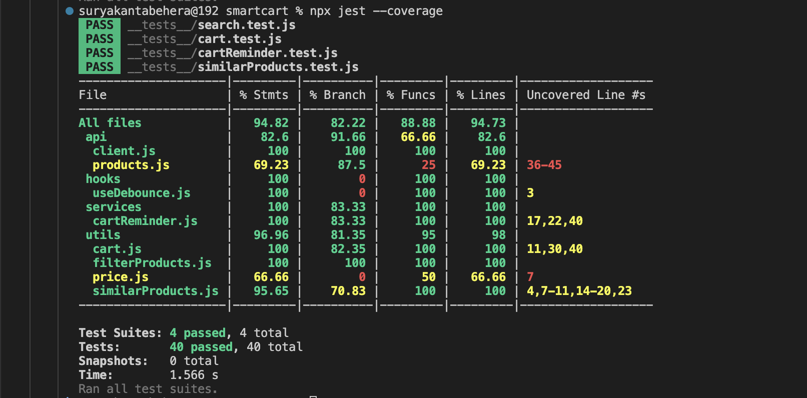

---

## Setup

### Requirements
- Node.js 20 or newer
- An Android phone with **Expo Go**, or an Android emulator

### Run locally
```bash
git clone https://github.com/Suryakanta10/smartcart.git
cd smartcart
npm install
npx expo start
```
Scan the QR code with Expo Go (phone and computer on the same Wi-Fi).

> **Note:** Expo Go has limited support for `expo-notifications` on Android. The rest of the app
> works in Expo Go, but to test reminders use the APK from the
> [Releases](https://github.com/Suryakanta10/smartcart/releases) page.

### Install the APK
1. Download `smartcart-v1.0.0.apk` from [Releases](https://github.com/Suryakanta10/smartcart/releases/latest).
2. Open it on an Android phone and allow installing from this source if asked.

### Build the APK yourself
```bash
npm install -g eas-cli
eas login
eas build -p android --profile preview
```
The `preview` profile in `eas.json` produces an installable `.apk`.

---

## Assumptions and Known Limitations

- **Orders are stored on the device.** DummyJSON doesn't persist checkout data, as noted in the
  assignment. See the backend section below for what a production version would need.
- **`minimumOrderQuantity` from the API is ignored.** It's mock data, and some values (e.g. 48)
  would block normal cart usage.
- **Server-side price sorting uses the original price**, while cards show the discounted price,
  so the order can look slightly off in a few cases.
- **Price and rating filters run on the client**, which works for DummyJSON's ~200 products but
  wouldn't scale to a large catalog.
- **Wishlist stores a stock snapshot.** A real app would re-check stock before moving an item to the cart.
- **Notification timing can be delayed** by Android battery optimizations (Doze).
- **JavaScript instead of TypeScript**, to spend the available time on features and tests.

## What a Production Backend Would Need

- `POST /orders`, `GET /orders`, `GET /orders/:id` to store orders on the server
- Cart sync per user so the cart follows the user across devices
- Stock validation and price confirmation at checkout
- A real payment gateway (e.g. Razorpay / Stripe) with server-side verification
- Server-side abandoned-cart detection with push notifications (FCM), instead of local notifications
- Search and filtering on the server (including price ranges and combined category + search)
- Authentication

## Future Improvements

- TypeScript
- `FlashList` for very large lists
- `react-native-mmkv` for faster storage
- Component tests for screens and end-to-end tests (Maestro / Detox)
- Dark mode

---

**Author:** Suryakanta Behera
