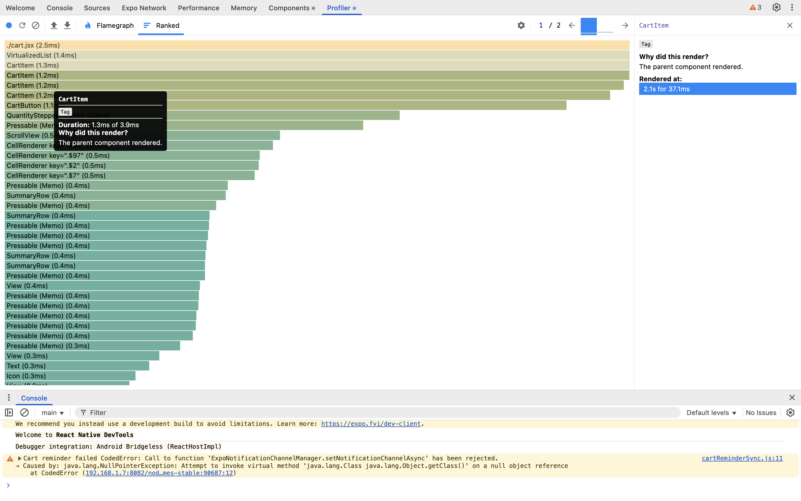

# Performance Notes

All measurements were taken with the React DevTools Profiler (React Native DevTools)
on a development build running in Expo Go on a Samsung Galaxy F07.
Development builds are slower than release builds, so the absolute timings are higher
than in production. What matters is how many components render, and the difference
between before and after.

Raw profiles are saved in `docs/profiler/` and can be opened in React DevTools
(Profiler tab → import button):

| File | What it contains |
|---|---|
| `before-cart.json` | Cart, one "+" tap, **without** `React.memo` on `CartItem` |
| `after-cart.json` | Cart, one "+" tap, with the optimizations in this repo |
| `after-list.json` | Product list, scrolling through several pages (143 commits) |

---

## 1. Cart: changing the quantity of one item

Scenario: the cart has 4 items, and I tap "+" on one of them.

| | `CartItem` renders | Commit render time |
|---|---|---|
| Before (no `memo`) | 4 (every row) | 37.1 ms |
| After | **1** (only the changed row) | **30.3 ms** |

The main result is the render count. Without `memo`, every row re-rendered when one quantity
changed. With `memo`, only the changed row renders. The other three are skipped because their
`item` objects keep the same reference: cart updates use `map` and only replace the changed item.

The timing difference looks smaller than the render count suggests, because the two recordings
were not identical. In the "after" recording, the details screen of the same product was still
mounted in the navigation stack and also re-rendered (about 4.7 ms), since it subscribes to that
product's quantity. That update is expected; a change to a different product would not re-render it.

| Before | After |
|---|---|
|  |  |

---

## 2. Product list: scrolling and loading more pages

Scenario: scrolling down the home list through several pages (143 commits recorded).

| Measurement (whole recording) | Result |
|---|---|
| `ProductCard` mounts (new cards appearing on screen) | 96 |
| **Existing `ProductCard` re-renders** | **0** |
| Commits where `HomeScreen` itself re-rendered (new page data, loading state) | 8 |
| `ProductCard` renders in those `HomeScreen` commits | **0** (with 19–23 cards mounted) |
| Heaviest commit (new cells rendered while scrolling) | 74.3 ms, 8 new cards, 0 old cards |

What this shows:

- When a new page arrives, `HomeScreen` re-renders (about 40 ms per commit), but **none** of the
  cards already on screen re-render. `React.memo` on `ProductCard` plus a stable `renderItem` and
  `onPress` (via `useCallback`) keep their props unchanged, so React skips them.
- While scrolling, the update starts at `VirtualizedList`, not at the screen. Only the cells that
  come into the render window are mounted (8 per batch, matching `maxToRenderPerBatch={8}`).
  In the flamegraph the existing cards are hatched ("did not render").
- Without `memo`, every `HomeScreen` render would re-render all mounted cards (about 20 per commit
  here), which is exactly what the cart "before" profile shows on a smaller scale.

---

## What was optimized and why

### Avoiding unnecessary re-renders
- `ProductCard`, `CartItem`, `QuantityStepper`, `SearchBar`, `CategoryChips`, `ImageGallery`
  and `SimilarProducts` are wrapped in `React.memo`.
- Callbacks passed to list items (`renderItem`, `onPress`, `onChangeQuantity`) are kept stable
  with `useCallback`, otherwise `memo` would not help.
- Derived data (the flattened product list, filtered products, cart totals) is computed with `useMemo`.
- Cart updates use `map`, so only the changed item gets a new object. Other rows keep their
  reference and skip rendering.
- Zustand selectors return only what a component needs:
  `useCartCount()` for the header badge, `useIsWishlisted(id)` for the heart icon, and the quantity
  of a single product on the details screen. Unrelated cart changes don't re-render them.

### FlatList
- `getItemLayout` with a fixed card height, so the list does not need to measure rows.
- `keyExtractor` with stable product ids.
- Tuned `initialNumToRender`, `maxToRenderPerBatch` and `windowSize`, plus `removeClippedSubviews`.
- `onEndReachedThreshold={0.5}` with a guard (`hasNextPage && !isFetchingNextPage`) so the next
  page is not requested twice.
- The search bar and category chips live outside the list, so typing does not re-mount list content.

### Network and images
- List requests use DummyJSON's `select` param to fetch only the fields a card needs.
  Full product details are fetched on the details screen.
- Search is debounced (400 ms), and outdated requests are cancelled through `AbortSignal`.
- React Query caches results (`staleTime` 5 min), and the cache is persisted for offline use.
- `expo-image` with `memory-disk` caching for product images.

---

## Possible next steps
- Switch to `FlashList` for very large lists.
- Use `react-native-mmkv` instead of AsyncStorage for faster, synchronous persistence.
- Move price/rating filtering to the backend so pagination works on filtered results.
- Profile a release build to get production timings.
